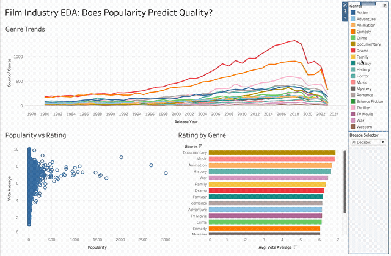
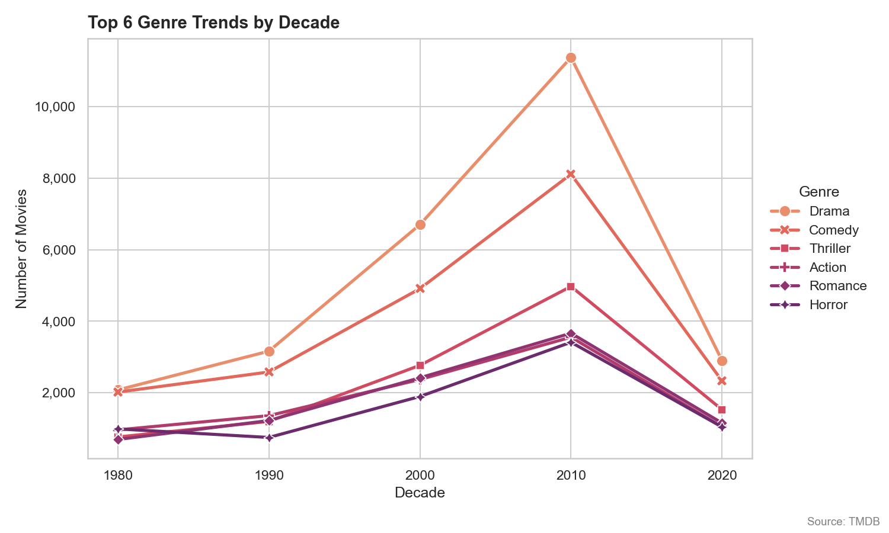
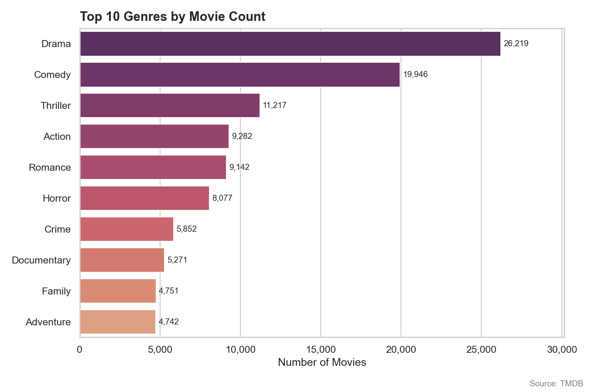
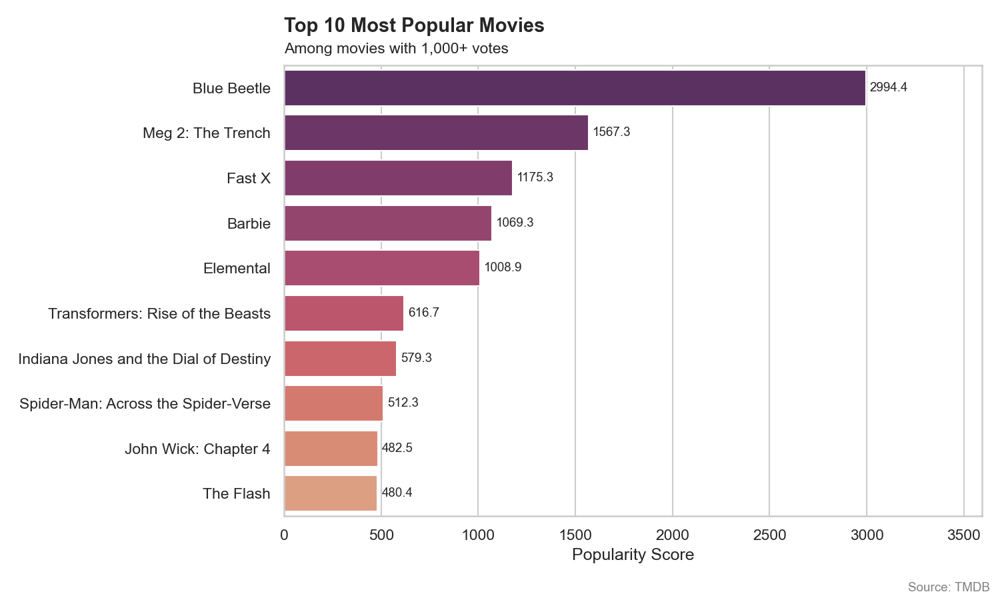

# TMDB Analytics Dashboard

*Streaming and studio decision-makers often conflate popularity with quality when greenlighting content; this analysis tests whether that assumption holds across 61,000+ films, with direct implications for content investment strategy.*

**Problem:** Determine whether genre, popularity, and release trends in film data reveal actionable patterns, and specifically test two industry assumptions: that popularity predicts quality, and that genre drives audience reception in a statistically meaningful way, across four decades of TMDB data.

**Architecture decision:** Loaded the raw CSV (1.5M rows) into a local SQLite database and used SQL to filter it before analysis in Python (pandas), keeping the filtering logic in one reproducible query. Excluded financial data (budget/revenue) entirely despite it being in the raw dataset, since only ~XX,XXX of 1.5M entries had both fields recorded, an unrepresentative subset not worth analyzing. Used a Welch two-sample t-test rather than a standard t-test for the Action vs. Drama comparison, since the two genre groups don't have equal variance. The analysis was later expanded into an interactive Tableau dashboard built on the same cleaned data, with a single parameter bridging two otherwise-separate data sources so one decade control filters both a movie-level view and a genre-level view simultaneously.

**What broke:** The original pipeline never filtered on TMDB's `adult` flag, so adult titles passed through to the cleaned exports and appeared in the Tableau dashboard. The fix added an `adult = 0` condition to the SQL query, after first checking how the flag was stored in SQLite (as integers `0`/`1`, not text), so the filter matched correctly instead of silently passing everything through.

**Metric:** Popularity and rating are nearly uncorrelated (Pearson r = 0.086, p < 0.001), popularity does not predict quality. Drama movies rate significantly higher than Action (6.27 vs. 5.95, p < 0.001) across 35,000+ films, a small but statistically robust gap.

## Interactive Dashboard

**[View the live Tableau dashboard →](https://public.tableau.com/app/profile/tariere.timitimi/viz/tmbd-tableau-dashboard/FilmEDADashboard)**

Built on the same cleaned dataset as the Python analysis, with three linked views (genre trends over time, popularity vs. rating, and average rating by genre), a shared decade parameter with an "All Decades" option, and click-to-filter genre comparison. The static analysis shows **Documentary and Music as the two highest-rated genres overall** (6.87 and 6.84), ahead of higher-volume genres like Drama and Comedy; filtering by decade in the dashboard shows this ranking holds in every decade, not just in aggregate.

## Key Questions
- Which genres are most represented in the film industry?
- How have genre trends shifted across decades?
- Which genres receive the highest audience ratings?
- How have average ratings changed over time?
- Which movies have the highest popularity scores?
- Is there a relationship between a movie's popularity and its rating?
- Do Action and Drama movies receive significantly different ratings?

## Workflow
CSV → SQLite Database → SQL Query → Python (pandas) → seaborn Visualizations → Statistical Tests → Tableau Dashboard

## Visualizations

| Plot | Description |
|------|-------------|
| `01_releases_per_year.png` | Number of movie releases per year (1980–2023) |
| `02_top_genres.png` | Top 10 genres by total movie count |
| `03_rating_by_genre.png` | Top 10 genres by average audience rating (genres with 500+ movies) |
| `04_genre_trends_decade.png` | How the top 6 genres have grown or declined by decade |
| `05_rating_by_decade.png` | Average audience rating per decade |
| `06_most_popular.png` | Top 10 most popular movies by TMDB popularity score (1,000+ votes) |

## Preview

## Statistical Analysis

**Pearson Correlation — Popularity vs. Rating**
Tests whether a movie's popularity score is related to its audience rating.

**Welch Two-Sample T-Test — Action vs. Drama Ratings**
Tests whether Action and Drama movies receive statistically different audience ratings.
- H₀: No significant difference in ratings between Action and Drama movies
- H₁: A significant difference exists

## Key Findings

**Popularity vs. Rating (Pearson Correlation, r = 0.086)**
Statistically significant but practically negligible relationship (r = 0.086, 95% CI [0.078, 0.094], p < 0.001, n = 61,884). Popularity and quality are largely independent, a movie can be widely watched without being highly rated, and vice versa.

**Action vs. Drama Ratings (Welch T-Test, p < 0.001)**
Drama movies rate statistically higher than Action movies (6.27 vs. 5.95 average rating, t = −24.6, p < 0.001) across 35,501 films (26,219 Drama, 9,282 Action). The 0.32-point difference (95% CI [0.29, 0.34]) is small but highly significant, suggesting audiences consistently reward narrative-driven films over action-oriented ones.

**Documentary and Music rank highest overall**
Documentary (6.87) and Music (6.84) are the two highest-rated genres among those with 500+ movies, ahead of higher-output genres like Drama (6.27), Comedy, and Action. The Tableau dashboard shows this ranking holds across every decade. Horror consistently ranks lowest across every decade tested, a stable pattern rather than an artifact of any single time period.

## Data & Filtering Decisions

**Source:** [TMDB Movies Dataset on Kaggle](https://www.kaggle.com/datasets/asaniczka/tmdb-movies-dataset-2023-930k-movies) (v11), 1,516,495 rows, 24 columns

**Filters applied** (61,884 movies remain):
- `status = 'Released'`, excludes movies still in production, planned, or cancelled
- `adult = 0`, excludes adult content
- `release_year >= 1980 AND release_year <= 2023`, focuses on four decades of modern cinema
- `vote_count >= 10`, removes entries with insufficient community ratings, reducing noise from obscure or low-quality entries

**Note on financial data:** Budget and revenue fields were excluded from this analysis. Only ~XX,XXX of 1.5M entries had both budget and revenue recorded, insufficient for meaningful analysis.

## Tech Stack
- **Language:** Python (originally built in R, later ported to Python)
- **Libraries:** pandas, NumPy, seaborn, matplotlib, SciPy, sqlite3
- **Database:** SQLite
- **Analysis:** Pearson Correlation, Welch Two-Sample T-Test
- **Visualization:** seaborn (static), Tableau (interactive dashboard)

## Reflection
A big dataset doesn't mean every column is usable. Deciding what to exclude, and being able to explain why, mattered as much as the statistical findings themselves, including catching adult titles that the original filters let through. Adding an interactive layer on top of a finished statistical analysis also showed that the top-rated genre ranking was stable across decades, something a single aggregate chart can't show, a reminder that a second visualization pass on the same data isn't purely redundant.
